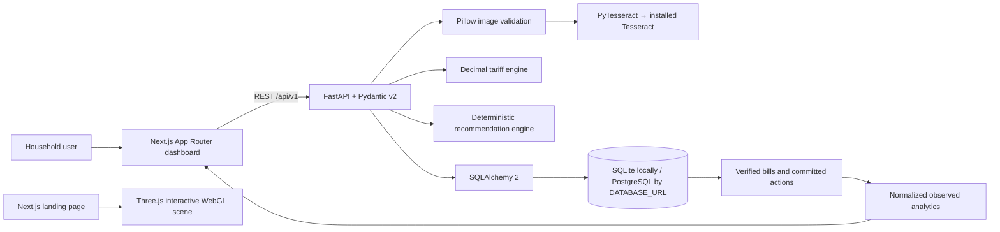

# VolteIQ

**Intelligence Behind Every Unit.**

VolteIQ is AI-powered household energy intelligence that transforms electricity bills into explainable recommendations and tracks observed energy changes over time. The current decision logic is deterministic and rule-based; it does not call a generative AI model or claim machine-learned predictions. The home page also contains a genuinely rendered, interactive Three.js energy model. Its scene is illustrative, not connected to live meter or solar hardware.

## Problem and approach

Household electricity bills combine consumption, billing periods, and multiple charges, while common energy advice rarely explains which action fits a household or whether later consumption changed. VolteIQ is designed to make the evidence trail visible:

**Understand → Decide → Act → Measure**

Upload a bill image for OCR candidates, review and explicitly verify the values, inspect assumptions behind ranked scenarios, commit an action, then compare later verified bills. Analytics report observed change only; the product does not claim a recommendation caused it.

## Implemented features

- **Bill intake and review:** PNG, JPEG, and TIFF uploads; configurable byte and pixel limits; MIME/content validation; Pillow decoding; PyTesseract OCR with a 20-second timeout; field evidence and uncertainty; editable verification fields; no persistence before explicit confirmation.
- **Bill history:** Verified consumption, inclusive billing dates/days, bill total and field provenance stored in SQLAlchemy. Same-owner duplicate/overlapping billing periods return a conflict.
- **Tariff estimate:** Configurable progressive marginal slabs using Decimal arithmetic and half-up paise rounding. The estimate covers energy charges only; it is not the utility bill total.
- **Explainable recommendations:** Appliance load-shifting scenarios and rooftop-solar scenarios from supplied inputs. Impact, ranking factors, assumptions, confidence basis and limitations are returned. Shifting does not reduce kWh; financial impact is calculated only when a TOU price difference is supplied. Solar assumptions are user-provided.
- **Action tracking:** Persisted commitments created from recommendations, with expected impact, units, start date and status.
- **Proof-loop analytics:** Saved verified bills plotted as billing-day-normalized kWh/day, with bill periods and observed change. Empty and loading states use no fabricated chart points.
- **Dashboard:** Responsive energy overview with a compact interactive 3D scene, persisted bill/action summaries, accessible section navigation, status/retry controls, tariff breakdown, recommendations and action history. Empty states use no invented usage values.
- **Bill intake:** Drag-and-drop or file selection for PNG, JPEG and TIFF; indeterminate upload/OCR wait status; editable extraction candidates and field provenance before explicit verification.
- **Interactive landing page:** Large WebGL smart-home model with gabled architecture, garden, solar panels, animated reflections, layered energy trails and particles, pointer parallax, drag orbit, hover emphasis, selectable solar/home/grid nodes, reset-view control, reduced-motion support and a WebGL fallback. The scene is illustrative and is not a meter feed.

## Architecture and data flow



The backend is under `backend/app/`: `main.py` exposes routes, `db.py` defines the SQLAlchemy engine/session/models, `ocr.py` extracts conservative text candidates, and `engines.py` contains tariff and recommendation calculations. Tests are in `backend/tests/`. The dashboard and styles are in `frontend/app/`.

## Technology

| Layer | Stack |
|---|---|
| API | Python 3.11+, FastAPI, Pydantic v2, Uvicorn |
| Persistence | SQLAlchemy 2.x, SQLite by default, PostgreSQL via psycopg 3 |
| OCR | Pillow, PyTesseract, external Tesseract executable |
| Web | Next.js 16 App Router, React 19, TypeScript strict mode |
| UI/data/3D | Tailwind CSS, Lucide React, Recharts, Three.js |
| Tests | pytest, FastAPI TestClient; ESLint, `tsc`, Next production build |

## Database schema

Tables are created with SQLAlchemy `Base.metadata.create_all` at application import/startup. No migration framework is included yet.

### `bills`

| Column | Purpose |
|---|---|
| `id` | Primary key |
| `owner_id` | Local demo owner scope; defaults to `demo` |
| `consumption_kwh` | User-verified consumption |
| `period_start`, `period_end` | Inclusive billing-period dates |
| `billing_days` | Inclusive period length |
| `total_amount_inr` | User-verified bill total, separate from tariff estimate |
| `verified` | Analytics include verified records only |
| `provenance` | JSON field-level source metadata |
| `created_at` | Record creation time |

There is a unique constraint on `(owner_id, period_start, period_end)` plus an owner/period index. The API also checks for any overlap before insert.

### `actions`

`id`, `owner_id`, `action_id`, `title`, `expected_impact`, `impact_unit`, `start_date`, `status`, and `created_at`. Actions default to `active`. The current schema does not enforce unique action identifiers or include a user-driven status transition API.

## Local setup

Requirements: Python 3.11+, Node.js 20.9+, npm, and the OS-level Tesseract executable for OCR. Install Tesseract using the package manager for your operating system. The deployed Render API container installs Tesseract; live health confirms the executable is available, but real-image OCR accuracy remains unverified.

From the project root, start the API:

```sh
python3 -m venv .venv
. .venv/bin/activate
pip install -r backend/requirements.txt
cp .env.example .env
uvicorn backend.app.main:app --reload --env-file .env
```

In another terminal, start the dashboard:

```sh
cd frontend
npm ci
cp .env.local.example .env.local
npm run dev
```

Open http://localhost:3000/dashboard. OpenAPI docs are at http://localhost:8000/docs. The frontend defaults to `http://localhost:8000`; change `NEXT_PUBLIC_API_BASE_URL` in `frontend/.env.local` if needed. The default CORS allowlist includes `localhost:3000` and `127.0.0.1:3000` for local development. Set an explicit restricted allowlist for any hosted environment.

For a production-mode frontend check, run `npm run build` and then `npm run start` from `frontend/` with the API running separately.

## Render deployment preparation

`render.yaml` describes separate Next.js and FastAPI web services plus a Render Postgres database. The API uses `backend/Dockerfile`, which installs the system Tesseract binary; the dashboard is built and started with production Next.js commands. The manifest configures health checks and the frontend/API origins. The deployed service URLs are `https://volteiq-web.onrender.com` and `https://volteiq-api.onrender.com`; the manifest configures matching `CORS_ORIGINS` and `NEXT_PUBLIC_API_BASE_URL`.

The live services are available at https://volteiq-web.onrender.com and https://volteiq-api.onrender.com. Render serves the Next.js landing page/dashboard, FastAPI API and PostgreSQL database. The dashboard has been verified making successful requests to saved bills, actions and analytics endpoints; the API health response reports database_available and ocr_available as true. Real-bill OCR has not been tested. Updates to the connected main branch trigger Render deployments. Render free services can spin down while idle; free Postgres expires after 30 days and has no backups, so use only non-sensitive demo records.

The manifest currently selects Render's free web services and free Postgres. Free web service filesystems are ephemeral, so SQLite must not be used for hosted records. The manifest wires the API to Postgres; Render's free Postgres currently expires 30 days after creation and has no backups. It is a short-lived hackathon demo option only, not durable production storage. Upgrade to a paid Postgres plan before long-term use. Free web services can spin down while idle. See Render's [free instance limitations](https://render.com/docs/free), [Next.js deployment guide](https://render.com/docs/deploy-nextjs-app), and [Blueprint reference](https://render.com/docs/blueprint-spec).

## Environment variables

| Variable | Default | Description |
|---|---|---|
| `DATABASE_URL` | `sqlite:///./lifepulse.db` | SQLAlchemy URL. The historical filename is retained for local-data compatibility. |
| `UPLOAD_MAX_BYTES` | `5242880` | Maximum uploaded image size (5 MiB). |
| `MAX_IMAGE_PIXELS` | `20000000` | Maximum decoded image pixel count. |
| `TESSERACT_CMD` | empty | Tesseract executable path if not on `PATH`. |
| `CORS_ORIGINS` | `http://localhost:3000,http://127.0.0.1:3000` | Comma-separated allowed browser origins. |
| `DEMO_OWNER_ID` | `demo` | Shared local owner scope; not authentication. |
| `TARIFF_CONFIG_ID` | `gujarat-illustrative-2026-01` | Identifier returned with tariff calculations. |
| `TARIFF_SLABS_JSON` | supplied defaults | Optional JSON list of `[slab_units, rate]` pairs; final slab uses `null` for no upper bound. |
| `NEXT_PUBLIC_API_BASE_URL` | `http://localhost:8000` | Browser-visible API origin, configured in `frontend/.env.local`. |

Example replacement slab configuration: `[[50,3.05],[50,3.50],[150,4.15],[null,5.20]]`. Rates are illustrative assumptions, not verified current official Gujarat tariffs.

## API reference

All routes are versioned under `/api/v1` and are documented by FastAPI at `/docs`.

| Method | Path | Purpose |
|---|---|---|
| `GET` | `/health` | Database and Tesseract executable status; HTTP 503 when the database is unavailable |
| `POST` | `/bills/upload` | Multipart image upload; actual OCR runs only when Tesseract is installed |
| `POST` | `/bills/verify` | Validate and persist explicitly verified fields |
| `GET` | `/bills` | Chronological saved bill list |
| `GET` | `/bills/{bill_id}` | Retrieve a bill in the local owner scope |
| `POST` | `/tariff/calculate` | Progressive slab estimate |
| `POST` | `/recommendations` | Calculate available appliance/solar/baseline recommendations |
| `POST` | `/actions` | Commit an action |
| `GET` | `/actions` | List saved actions |
| `GET` | `/analytics/savings` | Saved records and normalized observed changes |

### Tariff example

Request:

```json
{"consumption_kwh": 51}
```

The current illustrative configuration produces ₹156.00 of estimated energy charges: 50 units × ₹3.05 plus 1 unit × ₹3.50. The response also returns zero-unit entries for remaining configured slabs, effective rate, configuration identifier and limitations. It does not include fixed fees, duties, taxes, subsidies or other adjustments.

### Verify a bill

Example payload shape (values below are illustrative only):

```json
{
  "consumption_kwh": 123.4,
  "period_start": "2026-09-01",
  "period_end": "2026-09-30",
  "billing_days": 30,
  "total_amount_inr": 987.65,
  "provenance": {
    "consumption_kwh": {"source": "ocr_candidate_user_verified"}
  }
}
```

Dates use ISO `YYYY-MM-DD`. Billing days, if supplied, must match the inclusive date range. Overlap returns HTTP 409; invalid fields return HTTP 422. An OCR result is never saved automatically.

### Recommendation inputs

`POST /recommendations` accepts optional `appliance_watts`, `hours_per_use`, `uses_per_week`, `tou_saving_per_kwh`, `roof_area_m2`, `solar_capacity_kw`, `generation_kwh_per_kw_year`, `installed_cost_inr`, and `electricity_rate_inr`. Partial scenarios return notices rather than invented missing values. Solar estimates include no subsidy or live generation data.

## Calculation and interpretation

- Tariff calculations use `Decimal`, round each slab charge to paise with `ROUND_HALF_UP`, and apply progressive marginal rates.
- Appliance energy scenario: `watts × hours_per_use × uses_per_week ÷ 1000`. A time shift does not reduce kWh. A bill impact is calculated only from the user-supplied TOU price difference.
- Solar scenario: user-supplied capacity × assumed annual generation per kW; gross offset uses the supplied energy rate; simple payback divides supplied cost by gross annual offset. Actual output and economics can differ substantially.
- Recommendation ranks use fixed deterministic points and a stable tie-break. Scores are heuristics, not validated AI predictions.
- Analytics normalize consumption by saved billing days. Changes between bills are observations only, not evidence that an action caused the difference.

## Tests and checks

```sh
.venv/bin/python -m pytest -q
cd frontend
npm run lint
npm run typecheck
npm run build
npm audit --audit-level=moderate
```

Backend tests cover tariff boundaries and invalid inputs, Decimal rounding, recommendation determinism and uncertainty, OCR text candidate parsing, file validation and missing-Tesseract behavior, verification persistence, period conflicts, action history, and zero/one/multiple-bill analytics. The integrated API test follows verified bill → baseline recommendation → action commit → analytics. Synthetic records/text are test fixtures only. There are currently no dedicated frontend unit or component tests; lint, strict type checking, production build and manual browser checks of the landing/dashboard scene interactions are the frontend checks.

## Security, limitations and deployment status

- **OCR:** Tesseract is an OS dependency. OCR extraction is heuristic and must be checked by a person. The Render container installs Tesseract and the live health endpoint reports the OCR executable available. No real electricity-bill image has been tested, so extraction accuracy is unverified.
- **Authentication:** The public demo uses a shared owner ID but no login or per-user identity. CORS is not authentication. Do not upload private household bills: anyone who reaches the public API can access the shared demo records.
- **Tariffs and solar:** Gujarat tariff values are illustrative. No official current tariff, irradiation, market-price, export-credit or subsidy integrations exist.
- **Database operations:** `create_all` is used; no Alembic migrations, backups, retention policy or deletion workflow are implemented.
- **Runtime:** OCR is synchronous inside the upload endpoint despite its timeout. High-concurrency deployments should move image processing to a bounded worker queue and add request/rate limits.
- **Deployment:** Render deployment is live: the public homepage, dashboard, API health endpoint, and persisted PostgreSQL connection have been verified. Production authentication, custom domain, and observability are not implemented.
- **Repository:** The supplied source directory currently has no `.git` metadata, so commit history and clean/dirty Git status cannot be inspected here.

## Scalability considerations and roadmap

These are planned work, not current functionality:

1. Add real authentication, per-user ownership enforcement, account export/deletion and privacy controls.
2. Introduce Alembic migrations, PostgreSQL constraints for overlapping periods, backups and retention policy.
3. Move OCR to a bounded background queue with upload quotas, malware scanning, stronger monitoring and private object storage.
4. Cite official utility tariff schedules and date/version every tariff configuration.
5. Integrate independently verified solar/weather sources with source timestamps and explicit eligibility rules.
6. Add frontend component/E2E tests, user action lifecycle management and accessibility audits with assistive technology.
7. Deploy behind HTTPS, secrets management, restricted CORS, authentication, logging that excludes bill contents, and monitored database operations.

## Hackathon demonstration

1. On the demo machine, check `/api/v1/health` and confirm `ocr_available: true`; have a real sample bill ready.
2. Upload it, review extracted evidence and uncertainty, correct fields if necessary, then explicitly verify and save.
3. Show the saved billing period and distinguish the bill total from the illustrative slab energy estimate.
4. Supply scenario inputs, explain the ranking and assumptions, and commit an action.
5. Use a later, non-overlapping real bill to show persisted kWh/day analytics and action history. Describe changes as observed; do not imply causality.

The current inspected machine does not meet step 1: Tesseract and a real bill sample are unavailable. Verify that portion on the presentation machine before claiming the complete real-OCR workflow.
